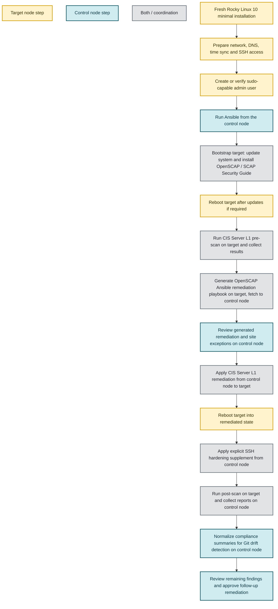

# Rocky 10 CIS Level 1 Hardening with an Ansible Control Node
## Hardening flow




Purpose of this page: define a traceable workflow for hardening Rocky Linux 10 VMs from a central Ansible control node according to CIS Server Level 1, rebooting them, scanning them, and later checking them for drift.

The approach is intentionally split into two layers:

1. **OpenSCAP / SCAP Security Guide** provides the CIS rules, scans, and a generated Ansible remediation playbook.
2. **Custom Ansible playbooks** add site policy, exceptions, SSH safeguards, report collection, and drift detection.

## Baseline

- Control node: Linux system with Ansible installed locally.
- Target systems: freshly installed Rocky Linux 10 VMs.
- Target profile: CIS Server Level 1.
- SCAP datastream on Rocky 10:

```text
/usr/share/xml/scap/ssg/content/ssg-rl10-ds.xml
```

- OpenSCAP profile:

```text
xccdf_org.ssgproject.content_profile_cis_server_l1
```

## Why use a control node instead of doing everything locally on the VM?

A control node gives you:

- central inventory for all Rocky 10 VMs
- reproducible execution per host or host group
- central storage for pre-/post-scan reports
- Git history for exceptions, reports, summaries, and drift
- clear separation between generated remediation and your own site policy
- better traceability of what was set automatically and what was intentionally excluded

Important: the generated OpenSCAP remediation should not be treated as permanently maintained code. It is an intermediate artifact generated from the current SCAP content. Stable decisions belong in your own playbooks and variables.

## Project structure

Recommended project structure:

```text
rocky10-cis-l1-hardening/
├── README.md
├── docs/
│   ├── runbook.md
│   ├── current-status.md
│   ├── wiki-rocky10-cis-l1-control-node.md
│   └── wiki-rocky10-cis-l1-control-node_en.md
├── inventory/
│   ├── rocky10-cis.example.ini
│   └── rocky10-cis.ini              # local, not necessarily committed
├── playbooks/
│   ├── 00-bootstrap-openscap.yml
│   ├── 20-apply-ssh-supplement.yml
│   └── 30-post-scan.yml
├── generated/
│   └── <hostname>/
│       └── remediate-cis-server-l1.yml
├── reports/
│   └── <hostname>/
│       ├── pre-hardening-report.html
│       ├── pre-hardening-results.xml
│       ├── post-hardening-report.html
│       ├── post-hardening-results.xml
│       └── post-validation-summary.txt
└── compliance-state/
    └── <hostname>/
        ├── exceptions.yml
        ├── last-scan-summary.yml
        ├── failed-rules.txt
        └── notes.md
```

Recommendation:

- Commit `playbooks/`, `docs/`, and example inventories.
- Commit `generated/` only when needed, because it is generated from SCAP content.
- Commit `reports/` and `compliance-state/` selectively if you want Git diffs for drift and historical findings.
- Do not store secrets, SSH keys, or passwords in Git.

## Inventory

Example:

```ini
[rocky10_cis]
vm01.example.ch
vm02.example.ch

[rocky10_cis:vars]
ansible_user=rockyadmin
ansible_become=true
ansible_become_method=sudo
ansible_python_interpreter=auto_silent
```

Before hardening, the following must be true:

- SSH works.
- The Ansible user can use `sudo`.
- The user remains allowed after SSH hardening, for example by being a member of `wheel`.
- Console, snapshot, or rescue access is available.
- The target VM does **not** need Ansible installed. Ansible runs on the control node and executes remote commands through SSH/Python. For the scan, the target only needs OpenSCAP / SCAP Security Guide and the baseline services.

Test connectivity:

```bash
cd /home/hermes/work/rocky10-cis-l1-hardening

ansible -i inventory/rocky10-cis.ini rocky10_cis -m ping
ansible -i inventory/rocky10-cis.ini rocky10_cis -b -m command -a 'id'
ansible -i inventory/rocky10-cis.ini rocky10_cis -m setup -a 'filter=ansible_distribution*'
```

Expected result:

- `ping: pong`
- `become` returns `uid=0(root)`
- Distribution is Rocky Linux, major version 10

## Phase 1: Initial bootstrap and pre-scan

Goal:

- update the target system
- install OpenSCAP and SCAP Security Guide
- run the pre-scan
- generate the remediation playbook
- fetch reports to the control node

Architecture note: operationally this is a remote scan. The control node starts everything via SSH/Ansible. No Ansible is installed on the target VM; the target only needs the OpenSCAP packages for scanning and generating the remediation.

Command:

```bash
ansible-playbook -i inventory/rocky10-cis.ini playbooks/00-bootstrap-openscap.yml --diff
```

Typical tasks on the target system:

- Install packages:
  - `openscap-scanner`
  - `scap-security-guide`
  - `audit`
  - `firewalld`
  - `chrony`
  - `policycoreutils-python-utils`

Not installed:

- `ansible` / `ansible-core` on the target VM. Remediation is started from the control node. The target VM only needs SSH, Python for Ansible modules, and the OpenSCAP tools for scanning/generation.

- Enable services:
  - `auditd`
  - `firewalld`
  - `chronyd`

- Verify datastream:

```bash
test -f /usr/share/xml/scap/ssg/content/ssg-rl10-ds.xml
```

- Run pre-scan:

```bash
oscap xccdf eval \
  --profile xccdf_org.ssgproject.content_profile_cis_server_l1 \
  --results /tmp/pre-hardening-results.xml \
  --report /tmp/pre-hardening-report.html \
  /usr/share/xml/scap/ssg/content/ssg-rl10-ds.xml
```

- Generate remediation:

```bash
oscap xccdf generate fix \
  --fix-type ansible \
  --profile xccdf_org.ssgproject.content_profile_cis_server_l1 \
  --output /tmp/remediate-cis-server-l1.yml \
  /usr/share/xml/scap/ssg/content/ssg-rl10-ds.xml
```

## Phase 2: Record global exceptions

Not every CIS rule should or can be applied automatically on every system. These decisions should not be manual changes on the VM. They belong in versioned site policy inside the project.

Example `compliance-state/global-exceptions.yml`:

```yaml
cis_exceptions:
  - rule_id: grub2_password
    decision: excluded
    reason: No GRUB password on these virtualized servers; console access is controlled through hypervisor/RBAC.
    scope: all_rocky10_vms
    owner: platform

  - rule_id: package_aide_installed
    decision: excluded
    reason: AIDE is not used; file integrity monitoring is covered by a central EDR/FIM solution.
    scope: all_rocky10_vms
    owner: security

  - rule_id: aide_periodic_cron_checking
    decision: excluded
    reason: Depends on AIDE; see exception package_aide_installed.
    scope: all_rocky10_vms
    owner: security
```

Important:

- Always document an exception with reason, scope, and owner.
- Keep global exceptions separate from host-specific exceptions.
- Do not hide exceptions inside the generated remediation playbook.
- If a rule cannot technically be fixed post-install, document it as an installation requirement.

Typical global candidates:

- no GRUB password on VMs
- no AIDE if another FIM/EDR solution is used
- no `systemd-journal-upload` when no central journal upload URL exists
- mount rules where partitioning must already be decided during OS installation
- FIPS if it was not enabled at install time

## Phase 3: Apply remediation

Review the generated playbook first:

```bash
less generated/<hostname>/remediate-cis-server-l1.yml
```

Review points:

- Is SSH hardened in a way that still allows the admin user to log in?
- Is `PermitRootLogin no` set, and is that intended?
- Are there `AllowGroups` rules, and is the Ansible user in that group?
- Are required services disabled?
- Do PAM and password rules match the environment?
- Are there rules that really need to be solved during installation?

Then apply it:

```bash
ansible-playbook -i inventory/rocky10-cis.ini generated/<hostname>/remediate-cis-server-l1.yml --diff
```

Reboot afterwards:

```bash
ansible -i inventory/rocky10-cis.ini rocky10_cis -b -m reboot -a 'reboot_timeout=900'
```

## Phase 4: Validate the reboot

After the reboot, first verify only reachability and baseline services:

```bash
ansible -i inventory/rocky10-cis.ini rocky10_cis -m ping
ansible -i inventory/rocky10-cis.ini rocky10_cis -b -m command -a 'id'
ansible -i inventory/rocky10-cis.ini rocky10_cis -b -m command -a 'sshd -t'
ansible -i inventory/rocky10-cis.ini rocky10_cis -b -m command -a 'systemctl is-active firewalld auditd chronyd'
```

If SSH no longer works:

- do not continue blindly with automation
- use console/snapshot/rescue access
- first check `sshd_config`, drop-ins, firewalld/nftables, and user groups
- verify `AllowGroups wheel` against the effective group membership of the admin user

## Phase 5: Post-hardening

After the first generated remediation, a custom supplement is usually needed. This supplement should be stable and intentionally maintained.

Example for SSH:

```bash
ansible-playbook -i inventory/rocky10-cis.ini playbooks/20-apply-ssh-supplement.yml --diff
```

Typical supplement tasks:

- set explicit SSH drop-ins
- validate `sshd -t`
- ensure firewalld SSH access
- apply local site exceptions, for example disable/mask `systemd-journal-upload` when no upload URL is configured
- re-enable monitoring/backup agents if generic remediation affected them
- remove temporary automation privileges if they were needed only for hardening

Example local exception:

```yaml
- name: Disable systemd-journal-upload when no upload URL is configured
  ansible.builtin.systemd:
    name: systemd-journal-upload.service
    enabled: false
    state: stopped
    masked: true
```

This exception is not a trick; it is an architecture decision: either configure central journal upload infrastructure or intentionally disable and document the service.

## Phase 6: Post-scan

Run the post-scan and fetch reports:

```bash
ansible-playbook -i inventory/rocky10-cis.ini playbooks/30-post-scan.yml --diff
```

Expected artifacts:

```text
reports/<hostname>/post-hardening-report.html
reports/<hostname>/post-hardening-results.xml
reports/<hostname>/post-validation-summary.txt
```

Important additional checks:

```bash
ansible -i inventory/rocky10-cis.ini rocky10_cis -b -m command -a 'getenforce'
ansible -i inventory/rocky10-cis.ini rocky10_cis -b -m command -a 'sshd -t'
ansible -i inventory/rocky10-cis.ini rocky10_cis -b -m command -a 'systemctl --failed --no-legend'
```

## Phase 7: Second remediation, second reboot, final scan

A robust production hardening workflow is:

1. pre-scan
2. first remediation
3. reboot
4. second remediation or supplement
5. reboot
6. final scan
7. capture state

Why twice?

- Some rules only take effect cleanly after reboot.
- Some services/policies are prepared by the first remediation but become fully active only afterwards.
- Post-reboot deviations become visible.
- The second result is closer to the real operating state.

Example sequence:

```bash
# 1. Bootstrap and pre-scan
ansible-playbook -i inventory/rocky10-cis.ini playbooks/00-bootstrap-openscap.yml --diff

# 2. First remediation
ansible-playbook -i inventory/rocky10-cis.ini generated/<hostname>/remediate-cis-server-l1.yml --diff

# 3. First reboot
ansible -i inventory/rocky10-cis.ini rocky10_cis -b -m reboot -a 'reboot_timeout=900'

# 4. Supplement / post-hardening
ansible-playbook -i inventory/rocky10-cis.ini playbooks/20-apply-ssh-supplement.yml --diff

# 5. Optional second generated remediation, if desired
ansible-playbook -i inventory/rocky10-cis.ini generated/<hostname>/remediate-cis-server-l1.yml --diff

# 6. Second reboot
ansible -i inventory/rocky10-cis.ini rocky10_cis -b -m reboot -a 'reboot_timeout=900'

# 7. Final scan
ansible-playbook -i inventory/rocky10-cis.ini playbooks/30-post-scan.yml --diff
```

## Drift detection with Git

Goal: later you want to see whether a VM has new rule violations or whether the compliance state has changed.

Each scan should therefore produce a normalized, diffable summary. HTML reports are useful for reading, but bad for Git diffs. XML is complete, but noisy. YAML/text files can also diff on every run if they contain timestamps, changing order, or other volatile values. Therefore, store a small, deterministically generated text/YAML summary in addition to the raw reports.

Recommended files per host:

```text
compliance-state/<hostname>/last-scan-summary.yml
compliance-state/<hostname>/failed-rules.txt
compliance-state/<hostname>/notchecked-rules.txt
compliance-state/<hostname>/exceptions-applied.yml
compliance-state/<hostname>/notes.md
```

Example `failed-rules.txt`:

```text
xccdf_org.ssgproject.content_rule_grub2_password
xccdf_org.ssgproject.content_rule_package_aide_installed
xccdf_org.ssgproject.content_rule_aide_periodic_cron_checking
```

Example `last-scan-summary.yml`:

```yaml
host: vm01.example.ch
os: Rocky Linux 10
profile: xccdf_org.ssgproject.content_profile_cis_server_l1
scan_time: 2026-06-02T18:00:00+02:00
score: 87.5
result_counts:
  pass: 210
  fail: 12
  notchecked: 4
  notapplicable: 33
exceptions_applied:
  - grub2_password
  - package_aide_installed
new_unexpected_failures: 0
```

Workflow:

```bash
# Run scan
ansible-playbook -i inventory/rocky10-cis.ini playbooks/30-post-scan.yml --diff

# Check normalized summary
git diff -- compliance-state reports

# If the state is intentionally accepted
git add compliance-state/<hostname>/ reports/<hostname>/post-validation-summary.txt
git commit -m "Update CIS L1 compliance state for <hostname>"
```

This lets you see later:

- new failed rules
- failed rules that disappeared
- changed exceptions
- score changes
- hosts that no longer match the expected state

## Important: normalize reports

Not everything is suitable for Git. Raw data and non-deterministically generated files can diff even when there is no new compliance violation in practice.

Do not use these as the primary Git diff source:

- HTML reports: good for humans, but not stable for machine diffs.
- XML results: complete, but noisy because of scan metadata, timestamps, tool/benchmark details, and structural noise.
- YAML/text with timestamps or unsorted lists: can diff on every run even when the same rules fail.

Recommendation:

- Keep HTML reports for humans, but do not necessarily commit every version.
- Keep XML results as raw data if audit evidence is important.
- Always generate a sorted text list of failed rules for Git diffs.
- Sort lists strictly by `rule_id` and remove duplicates.
- Write YAML keys in a fixed order.
- Keep timestamps, random IDs, and host-specific volatile data out of diff target files.

Example future helper task:

```bash
python3 scripts/extract-oscap-summary.py \
  reports/<hostname>/post-hardening-results.xml \
  compliance-state/<hostname>/last-scan-summary.yml \
  compliance-state/<hostname>/failed-rules.txt
```

## Regular re-checks

After initial hardening, the same control node can usually run scan-only checks:

```bash
ansible-playbook -i inventory/rocky10-cis.ini playbooks/30-post-scan.yml --diff
```

Afterwards:

```bash
git diff -- compliance-state/<hostname>/ reports/<hostname>/post-validation-summary.txt
```

Interpretation:

- No diff: state unchanged.
- Only score/date changed: improve normalization if that is noisy.
- New rule in `failed-rules.txt`: new violation or changed SCAP content.
- Rule disappeared: system was fixed or SCAP content changed.
- Many new rules after a package update: SCAP content or OS baseline changed; review required.

## Optional: automatic post-hardening

Checking and remediating are not the same thing.

Recommended model:

- **Scan-only job**: safe, regular, reports drift.
- **Remediation job**: deliberately triggered manually or during a change window.

Why not always remediate automatically?

- CIS remediation can change SSH, PAM, bootloader, services, and firewall.
- New SCAP content can contain new rules.
- Automatic remediation without review can affect production services.

Useful workflow when drift appears:

1. Scan-only shows new failed rules.
2. Review the diff.
3. Decide:
   - fix a real violation
   - document a new exception
   - run remediation during a change window
4. Reboot and run the final scan afterwards.
5. Commit compliance state.

## Minimal daily operation

For existing hardened VMs, this is usually enough:

```bash
cd /home/hermes/work/rocky10-cis-l1-hardening

ansible -i inventory/rocky10-cis.ini rocky10_cis -m ping
ansible-playbook -i inventory/rocky10-cis.ini playbooks/30-post-scan.yml --diff
git diff -- compliance-state reports
```

If the diff contains only expected changes:

```bash
git add compliance-state reports/*/post-validation-summary.txt
git commit -m "Update Rocky 10 CIS L1 compliance state"
```

If new unexpected violations appear:

```bash
# Analyze first, then remediate deliberately
ansible-playbook -i inventory/rocky10-cis.ini playbooks/20-apply-ssh-supplement.yml --diff
ansible-playbook -i inventory/rocky10-cis.ini playbooks/30-post-scan.yml --diff
git diff -- compliance-state reports
```

## What belongs in custom playbooks?

Custom playbooks should contain everything that is site policy or where OpenSCAP lacks enough context:

- allowed SSH groups and root login policy
- firewalld baseline
- journald/rsyslog/remote logging decision
- AIDE yes/no
- GRUB password yes/no
- monitoring/backup agent exceptions
- local admin groups
- removing temporary automation privileges
- report normalization for Git diffs

## What does not belong in generated remediation?

Do not permanently maintain these manually inside the generated playbook:

- local exceptions
- host group policy
- audit comments
- manual fixes that will be lost on the next generate run

If a generated playbook has a known generator bug, you can patch it automatically after generation. That patch logic should live in a custom script or playbook, not as manual edits to the file.

## Risks and safeguards

| Risk | Safeguard |
|---|---|
| SSH lockout | non-root admin user in allowed group, console/snapshot, `sshd -t`, check firewalld SSH |
| Root login disabled | intended; ensure admin user with sudo first |
| PAM/password policy blocks user | check before remediation, keep a test login open |
| firewalld/nftables blocks access | allow SSH service permanently and at runtime, console fallback |
| GRUB/FIPS/mount rules not fixable post-install | document as installation requirement or exception |
| AIDE causes operational overhead | enable intentionally or document a global exception |
| Automatic remediation affects services | run remediation only after review/change window |

## Recommended target architecture

- `inventory/`: defines host groups.
- `playbooks/00-bootstrap-openscap.yml`: installs scanner, runs pre-scan, generates remediation.
- `generated/<hostname>/`: contains generated remediation per host.
- `playbooks/20-apply-ssh-supplement.yml`: stable site hardening after generated remediation.
- `playbooks/30-post-scan.yml`: scans and fetches reports.
- `compliance-state/`: normalized, diffable state files.
- `docs/`: runbook, wiki page, status, and architecture decisions.
- Git: versions policy, exceptions, summaries, and intentionally accepted state changes.

## Clean end-to-end workflow

```bash
cd /home/hermes/work/rocky10-cis-l1-hardening

# 0. Check inventory
ansible -i inventory/rocky10-cis.ini rocky10_cis -m ping
ansible -i inventory/rocky10-cis.ini rocky10_cis -b -m command -a 'id'

# 1. Bootstrap + pre-scan + generate remediation
ansible-playbook -i inventory/rocky10-cis.ini playbooks/00-bootstrap-openscap.yml --diff

# 2. Review generated remediation
less generated/<hostname>/remediate-cis-server-l1.yml

# 3. Initial hardening
ansible-playbook -i inventory/rocky10-cis.ini generated/<hostname>/remediate-cis-server-l1.yml --diff

# 4. Reboot
ansible -i inventory/rocky10-cis.ini rocky10_cis -b -m reboot -a 'reboot_timeout=900'

# 5. Post-hardening / apply site policy
ansible-playbook -i inventory/rocky10-cis.ini playbooks/20-apply-ssh-supplement.yml --diff

# 6. Optional second reboot
ansible -i inventory/rocky10-cis.ini rocky10_cis -b -m reboot -a 'reboot_timeout=900'

# 7. Final scan and state capture
ansible-playbook -i inventory/rocky10-cis.ini playbooks/30-post-scan.yml --diff

# 8. Review diff
git diff -- reports compliance-state
```

## Decision: what does compliant mean?

For this workflow, a system is not considered clean just because OpenSCAP reports 100 percent. It is clean when:

- all technically reasonable CIS L1 rules are applied
- all non-applied rules have documented exceptions
- the final scan is reproducible
- SSH, sudo, auditd, firewalld, chrony, and SELinux are validated
- no unexpected failed units exist
- the state is stored as a diffable summary in Git
- new deviations become visible later through Git diff

## Next useful project extensions

1. Create `compliance-state/global-exceptions.yml` as a real file.
2. Build `scripts/extract-oscap-summary.py` to normalize XML into YAML/text.
3. Extend `playbooks/30-post-scan.yml` so it generates `compliance-state/<hostname>/failed-rules.txt`.
4. Optionally build `playbooks/40-remediate-drift.yml`, which only runs approved post-hardening actions.
5. Define a clear `.gitignore` policy for large HTML/XML reports.